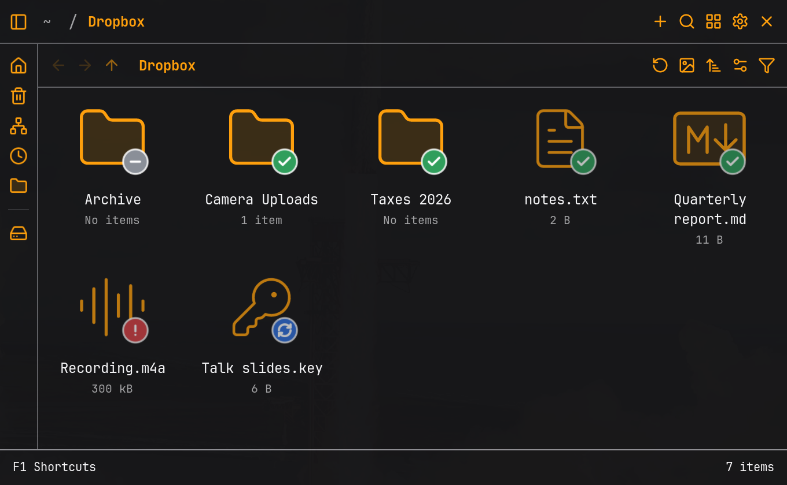
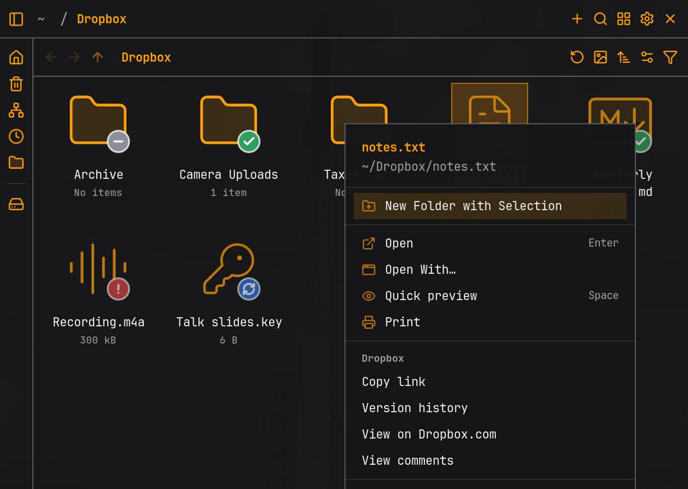
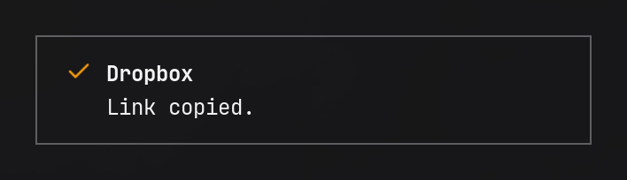

# Strata Dropbox

[](https://github.com/joaodrp/strata-dropbox/actions/workflows/ci.yml)
[](LICENSE)

Dropbox sync badges and right-click actions for the [Strata](https://stratafiles.io/) file
manager.



## Highlights

- ✅ Badges for synced, syncing, can't sync and excluded files.
- 🔄 Badges update when a sync finishes.
- 🔗 Copy link, Version history, View on Dropbox.com and View comments in the right-click menu.
- 🪶 Uses the Dropbox client you already run. One Python file, no sign-in.

## Install

```sh
curl -fsSL https://raw.githubusercontent.com/joaodrp/strata-dropbox/main/install.sh | bash
```

Then in Strata open **Settings -> Integrations** and select **Refresh**.

The [installer](install.sh) copies `provider.py` and the badge images into
`~/.config/strata/providers/dropbox/`. From a clone, run `./install.sh`.

## Badges

| Badge | Means |
| --- | --- |
|  | Synced: this computer and Dropbox match |
|  | Syncing: uploading or downloading now |
|  | Can't sync: check the Dropbox client |
|  | Excluded: ignored, or left out of this computer by selective sync |

A sync error wins over other providers' badges on the same file. Files outside Dropbox get no
badge.

## The Dropbox menu

Right-click anything in your Dropbox:



| Action | Does |
| --- | --- |
| Copy link | Copies a Dropbox link to your clipboard, one per line for several items (up to 20) |
| Version history | Opens the file's earlier versions on Dropbox.com |
| View on Dropbox.com | Opens the file or folder on Dropbox.com |
| View comments | Opens the file's comments on Dropbox.com |

Folders get fewer actions than files. Copy link confirms with a notice:



**Copy link creates a link if the file has none.** Anyone with the link can see the file.

**Do not sync is left out.** It [removes the file from Dropbox.com and your other
devices](https://help.dropbox.com/sync/ignored-files), and Strata can't ask you to confirm.
Use the Dropbox client for it.

## Requirements

- [Strata](https://stratafiles.io/) 1.1.1 or newer
- The [Dropbox desktop client](https://www.dropbox.com/install-linux), running
- Python 3.10 or newer, at `/usr/bin/python3` or on `PATH`
- `wl-copy` (`wl-clipboard`) for Copy link

## Troubleshooting

| You see | Try |
| --- | --- |
| No badges at all | Dropbox is not running, or the files are outside your Dropbox folder. Check with `dropbox-cli status` |
| Dropbox missing from Integrations | Select **Refresh**, or restart Strata |
| No Dropbox actions in the menu | The selection includes something outside your Dropbox, or Dropbox is not running |
| "This menu expired" | The menu was open for over two minutes. Open it again |

## Privacy

- No network connections of its own. It only talks to the local Dropbox client.
- It never reads your files, only asks about paths inside your Dropbox.
- Nothing changes until you choose an action.

See [how it works](docs/how-it-works.md).

## Update

Run the installer again, then select **Refresh** in Strata.

## Remove

```sh
curl -fsSL https://raw.githubusercontent.com/joaodrp/strata-dropbox/main/install.sh | bash -s -- --uninstall
```

Or select the bin icon next to Dropbox in **Settings -> Integrations**.

## Contributing

See [CONTRIBUTING.md](CONTRIBUTING.md).

## License

MIT, see [LICENSE](LICENSE). Badge glyphs from [Lucide](https://lucide.dev/), ISC, see
[icons/LICENSE-lucide](icons/LICENSE-lucide). Not affiliated with Dropbox or Strata.
